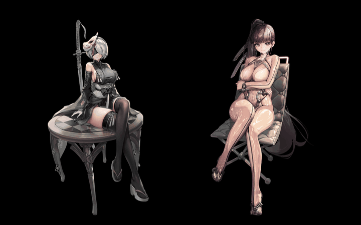
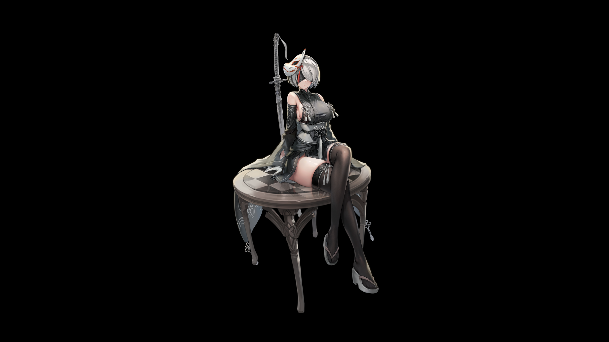
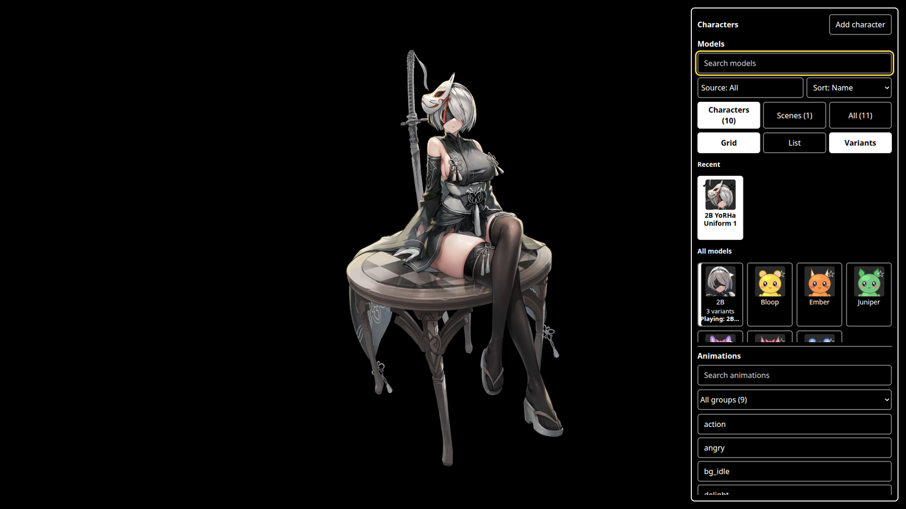
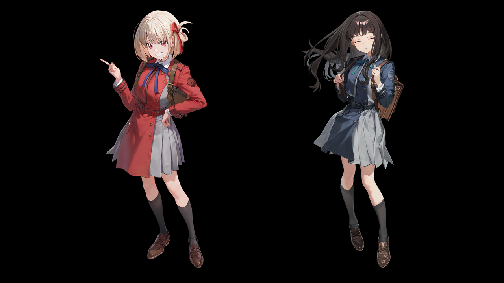
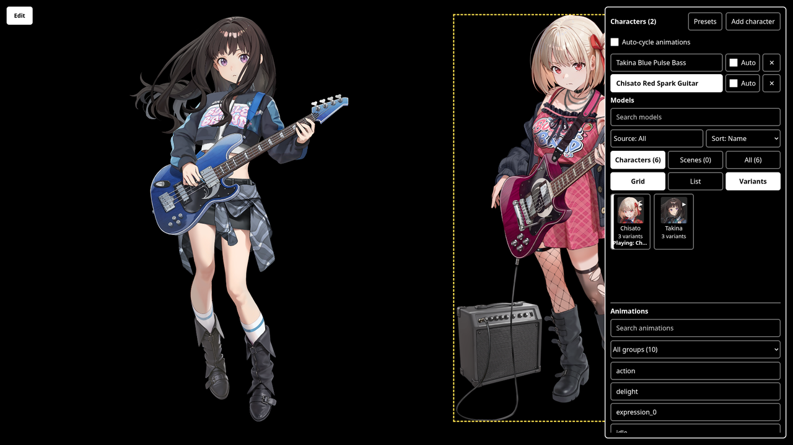
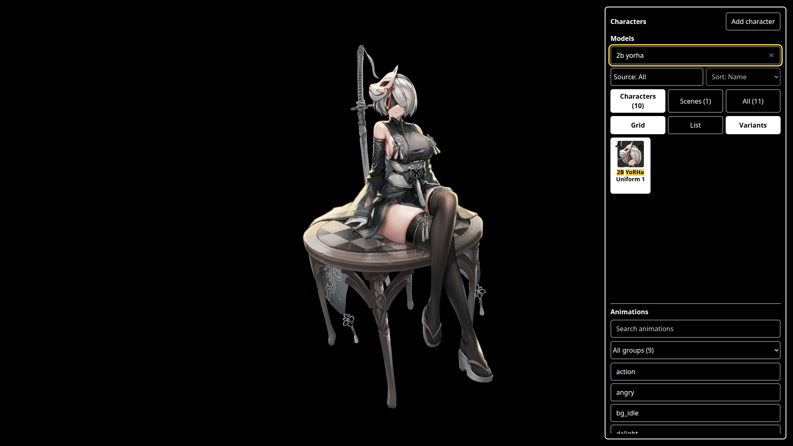

# spinewall

[](https://github.com/officialdad/spinewall/actions/workflows/ci.yml)
[](https://github.com/officialdad/spinewall/releases)
[](LICENSE)

Live 2D animated characters as a KDE Plasma 6 wallpaper, on a black background. Click a character to change its animation.

Spinewall works with any Spine 3.7 (JSON export only), 3.8, 4.0, 4.1, or 4.2 model. It is not tied to one game.

<table>
<tr>
<td align="center"><br><sub>Two characters on one wallpaper, each playing its own animation. <a href="docs/images/hero.mp4">Smaller MP4</a></sub></td>
</tr>
</table>

## Live demo

Try it in the browser at [officialdad.github.io/spinewall](https://officialdad.github.io/spinewall/). The demo has a few sample variants of two characters. Pick a variant, play an animation, add a second character, drag to move, and scroll to scale. It needs no install and runs only in your browser.

## What it looks like

In normal mode the desktop shows only the character. Click it to change its animation.

Edit mode opens a panel on the right. Use it to choose models and animations, and to move and scale characters. Right-click the desktop and choose "Enter Edit Mode" to open it.

<table>
<tr>
<td align="center"><br><sub>Normal mode: only the character</sub></td>
<td align="center"><br><sub>Edit mode: the model picker and animation list</sub></td>
</tr>
</table>

In edit mode you can:

- Search models with fuzzy matching, and filter by source, favorites, recents, and Characters, Scenes, or All.
- Group the variants of one character into a single card.
- Save the characters, positions, and sizes on screen as a named preset, and load it again later.
- Play any animation from the list, with a preview on hover.
- Drag the character to move it. Scroll the mouse wheel to scale it.
- Add more characters with "Add character". Press a character to select it. A click changes only the topmost character under the pointer.

Spinewall draws several characters on one wallpaper. Each character keeps its own model, animation, position, and scale. In edit mode, the Characters list shows every character on screen. A dashed yellow box marks the selected one.

<table>
<tr>
<td align="center"><br><sub>Two characters, normal mode</sub></td>
<td align="center"><br><sub>Two characters, edit mode</sub></td>
</tr>
<tr>
<td align="center" colspan="2"><br><sub>Fuzzy search in the picker</sub></td>
</tr>
</table>

The characters in these images are the property of SHIFT UP Corporation. Spinewall is not affiliated with SHIFT UP. They are shown to demonstrate the interface only. The only models in this repository are the few samples for the live demo, under `docs/demo/models/`. Spinewall does not install any models.

## Spine, not Live2D Cubism

"Live 2D" can mean two different formats. Spinewall plays only [Spine](https://esotericsoftware.com) skeletal animation.

| | Spine (supported) | Live2D Cubism (not supported) |
|---|---|---|
| Maker | Esoteric Software | Live2D Inc. |
| Files | `.skel` or `.json`, `.atlas`, PNG pages | `.moc3`, `.model3.json`, textures |
| Method | Image pieces attached to bones | Textured meshes driven by parameters |

A model with `.moc3` files will not load. Many viewers and games call their Spine characters "Live2D", so check the file extensions.

## How it works

- The `webwallpaper-kde` plugin shows a web page as the desktop background.
- The `spinewall` theme is that page. It draws the model with the Spine WebGL player.
- A local Python server on `127.0.0.1:8777` holds the state: model, animation, zoom, position.
- The page polls the server. The `spinewall` CLI and global shortcuts send commands to it.

## Input

| Mode | Input | Action |
|---|---|---|
| Normal | Left click | Next animation of the topmost character under the pointer |
| Edit | Left drag | Move the selected character |
| Edit | Mouse wheel | Zoom the selected character |
| Edit | Short left click | Next animation, or select the character |
| Edit | Keyboard in the picker | Search, arrow keys, Enter, Ctrl+Enter to add a character |

Edit mode opens a model picker with fuzzy search, a source filter, favorites, recents, character-variant grouping, a Characters / Scenes / All filter, an animation list with hover preview, and a strip for several characters at once. See [docs/assets.md](docs/assets.md).

Enter edit mode from the Plasma desktop menu: right-click the desktop, then choose "Enter Edit Mode". Hold-to-edit is disabled by the plasmoid patch.

## Requirements

- KDE Plasma 6 on Wayland or X11. Tested on Plasma 6.8.1, Wayland.
- [`webwallpaper-kde`](https://github.com/ekoputrapratama/webwallpaper-kde), installed and working.
- `python3`, `npm`, `curl`, `patch`, `systemd` (user session).
- Spine models. See [docs/assets.md](docs/assets.md).

## Supported versions

| Component | Version |
|---|---|
| KDE Plasma | 6.x. The containment patch targets 6.8.1. |
| Spine models | 3.7 (JSON only), 3.8, 4.0, 4.1, 4.2 |
| Spinewall | The latest release. See [SECURITY.md](SECURITY.md). |

## Install

Download the latest `spinewall-X.Y.Z.tar.gz` and `SHA256SUMS` from the [releases page](https://github.com/officialdad/spinewall/releases). Run `sha256sum -c SHA256SUMS`, extract the archive, and run the steps below from the extracted directory. A git clone works too.

1. Install `webwallpaper-kde` and restart plasmashell. Follow its README.
2. Run `scripts/install.sh`. It fetches the Spine runtimes (npm for 4.x, a pinned `spine-runtimes` commit for 3.7 and 3.8), installs the theme, the server, the CLI, and the user service.
3. Run `scripts/patch-plasmoid.sh`. It lets left clicks reach the wallpaper. See the warning below.
4. Restart plasmashell: `systemctl --user restart plasma-plasmashell.service`.
5. Put models in `~/.local/share/spinewall/models/`. See [docs/assets.md](docs/assets.md).
6. Restart the server: `systemctl --user restart spinewall.service`.
7. Right-click the desktop, open "Configure Desktop and Wallpaper", choose "WebWallpaper", and pick the `spinewall` theme.

## CLI

```
spinewall info
spinewall next-model | prev-model | random-model | set-model ID
spinewall next-anim | prev-anim | random-anim | set-anim NAME
spinewall zoom-in | zoom-out | move-left | move-right | move-up | move-down | reset-view
spinewall rescan
spinewall add-character [ID] | remove-character UID | clear-characters
spinewall next-char-anim UID | prev-char-anim UID | set-char-anim UID NAME | set-char-model UID ID
spinewall presets | save-preset NAME | load-preset NAME | delete-preset NAME
```

Bind these to global shortcuts in System Settings, under Shortcuts, with a custom command.

## Code map

| Path | Job |
|---|---|
| `theme/index.html` | The wallpaper page. One file, no build step. |
| `theme/local-host.js` | Local mode. Runs the server's state logic in the page, with `localStorage` for state and prefs. |
| `server/spinewall-server.py` | Local HTTP server. State, model scan, prefs, layout, thumbnails. |
| `bin/spinewall` | CLI. Thin `curl` wrapper over the server. |
| `scripts/build-demo.py` | Builds the Pages demo from `theme/index.html` in local mode. |
| `scripts/package-windows.py` | Builds the Lively zip and Wallpaper Engine files for Windows. See [docs/windows.md](docs/windows.md). Unconfirmed on Windows. |
| `scripts/install.sh` | Installs theme, server, CLI, and user service. Fetches the runtimes. |
| `scripts/patch-plasmoid.sh` | Applies `plasma/desktopcontainment.patch`. |
| `systemd/spinewall.service` | User service for the server. |
| `docs/assets.md` | Model layout and `model.json` keys. |
| `docs/credits.md` | Sources, tools, and test models. |

### `theme/index.html`

| Area | Functions |
|---|---|
| Config and runtimes | `RUNTIMES` (`spine37`, `spine38`, `spine40`, `spine41`, `spine42`), `API`, `LOCAL`, `MODEL_ROOT`, `api`, `POLL_MS`, click and scale limits |
| View and polling | `applyView`, `pushView`, `poll`, `load`, `setEditMode` |
| Picker data | `refreshPrefs`, `fuzzy`, `matchModel`, `comparator`, `buildItems` |
| Picker UI | `ensureChrome`, `renderPicker`, `computeLayout`, `renderWindow`, `makeCell`, `drawRail`, `setupRailScrub`, `onSearchKey` |
| Animation list | `drawingAnimations`, `animGroups`, `renderAnims`, `previewAnim`, `endPreview` |
| Thumbnails | `wantThumb`, `pumpThumbs`, `loadOrMakeThumb`, `renderThumb`, `headBox`, `unionBox` |
| Stage (all characters) | `makeLayer`, `createStageChar`, `stageFrame`, `frameOf`, `applyCharacters`, `destroyLayers` |
| Hit testing | `hitTest`, `charContains`, `inTriangle`, `selectChar` |
| Scenes | `hideSlotsOf`, `kind` filter in `buildItems` |

### `theme/local-host.js`

| Area | Functions |
|---|---|
| Entry | `createLocalHost` answers the server paths from memory and `localStorage`. |
| Model list | `completeModels` fills the fields a server scan derives. |
| State | `runCommand`, `setView`, `changeModel`, `changeAnimation`, `setLayout`, `cleanCharacters` |

Local mode starts with `?local=<models index url>` or `window.SPINEWALL_LOCAL = {modelsUrl}`. The index is `{"runtime": "4.1.56", "models": [...]}` like `docs/demo/models/index.json`. The model folders sit beside it. A visible Edit button replaces the Plasma patch.

### `server/spinewall-server.py`

| Area | Functions |
|---|---|
| Model scan | `read_binary_version`, `read_json_version`, `read_atlas_regions`, `classify_kind`, `scan_model`, `scan_models`, `assign_characters`, `rescan` |
| State | `STATE`, `load_state`, `save`, `change_model`, `change_animation`, `set_view` |
| Prefs | `load_prefs`, `save_prefs`, `toggle_favorite`, `record_recent`, `set_prefs` |
| Presets | `save_preset`, `load_preset`, `delete_preset`, `current_characters`, `clean_preset`, `clean_presets`, `clean_preset_name` |
| Characters | `add_character`, `remove_character`, `update_character`, `cycle_character_animation`, `set_layout`, `clean_characters` |
| HTTP | `command`, `Handler`: `/state`, `/models`, `/prefs`, `/info`, `/rescan`, `/presets`, `/thumb/<id>.png`, `/cmd/...`, `/edit/0\|1`, `/report`, `/fav/<id>`, `/layout`, `/view`, `/input` |

Data flow, state keys, and rules are in `CLAUDE.md`.

## Test models

Models are never committed, except the demo samples in `docs/demo/models/`. Test with the Esoteric Software example projects from the [spine-runtimes](https://github.com/EsotericSoftware/spine-runtimes) repo (`spineboy`, `raptor`, `goblins`, `hero`, `vine`, `stretchyman`, in 4.0 and 4.1), and with models you own.

1. Copy a model directory into `~/.local/share/spinewall/models/`.
2. Run `spinewall rescan`.
3. Run `spinewall set-model spineboy-4.1`.

See [docs/assets.md](docs/assets.md) for the layout.

## Credits

See [docs/credits.md](docs/credits.md).

- [Esoteric Software](https://esotericsoftware.com): Spine and [spine-runtimes](https://github.com/EsotericSoftware/spine-runtimes).
- [webwallpaper-kde](https://github.com/ekoputrapratama/webwallpaper-kde): the web page wallpaper plugin.
- [Nikke-db](https://github.com/Nikke-db): open-source viewer studied for skin handling and viewer behavior.

## Plasmoid patch warning

`plasma/desktopcontainment.patch` changes a copy of the Plasma desktop containment. The copy lives in `~/.local/share/plasma/plasmoids/org.kde.desktopcontainment` and shadows the system one.

The patch has three effects:
- Desktop icons no longer take left clicks, so the click reaches the wallpaper.
- Hold-to-enter-edit-mode is off.
- The containment tells the server when edit mode starts and stops.

Run `scripts/patch-plasmoid.sh` again after every `plasma-desktop` update. A stale copy can break the desktop. To undo, remove the local directory and restart plasmashell.

## First run

1. Copy one model into `~/.local/share/spinewall/models/`.
2. Run `spinewall rescan`, then `spinewall info`. The `models` count must rise.
3. Run `spinewall set-model <id>`.
4. Right-click the desktop and choose "Enter Edit Mode" to open the picker.

## Security

The server listens on `127.0.0.1` only. See [SECURITY.md](SECURITY.md) to report a problem.

## Contributing

Read [CONTRIBUTING.md](CONTRIBUTING.md) and [CODE_OF_CONDUCT.md](CODE_OF_CONDUCT.md). Releases are automatic. See [docs/releasing.md](docs/releasing.md).

## Legal notice

Spinewall is a viewer. It includes no Spine runtime. The only models are the few samples for the live demo, shown as samples only under `docs/demo/models/`, and removed on request from their owners. `scripts/install.sh` fetches the runtimes from Esoteric Software. Each user needs their own Spine Editor license under the Spine Runtimes License. The demo characters and all related art and models are the property of SHIFT UP Corporation. Spinewall is a fan project. SHIFT UP does not sponsor, endorse, or affiliate with it. Other game characters and art belong to their owners, and Spinewall has no affiliation with them. Use only models you own or have the right to use, for personal non-commercial use. The MIT license covers this repository's code only.

## Configuration

| Variable | Default | Use |
|---|---|---|
| `SPINEWALL_PORT` | `8777` | Server and CLI port. The theme and the Plasma patch hardcode `8777`, so a changed port breaks the wallpaper. |
| `SPINEWALL_MODELS` | `~/.local/share/spinewall/models` | Model directory. |
| `SPINEWALL_CONFIG` | `~/.config/spinewall/config.json` | Config file. `additional_model_dirs` lists more model directories, see [docs/assets.md](docs/assets.md). |
| `SPINEWALL_STATE` | `~/.local/state/spinewall/state.json` | Current model, animation, and view. |
| `SPINEWALL_PREFS` | `~/.local/state/spinewall/prefs.json` | Favorites, recents, sort, filters, presets. |
| `SPINEWALL_LAYOUT` | `~/.local/state/spinewall/layout.json` | Several-character layout. |
| `SPINEWALL_THUMBS` | `~/.cache/spinewall/thumbs` | Thumbnail cache. |

The server listens on `127.0.0.1` only and rejects requests with another `Host` header. It has no login. Any local user can send it commands.

## Troubleshooting

| Symptom | Action |
|---|---|
| Blank wallpaper | Run `spinewall info`. Check `models` and `skipped`. Restart plasmashell. |
| A model is missing | Run `spinewall rescan`. Read its reason under `skipped`. |
| A model has no picture | Run the atlas page check in [docs/assets.md](docs/assets.md). |
| Clicks do nothing | Run `scripts/patch-plasmoid.sh` again and restart plasmashell. Check that `input.fired` rises. |
| Black or broken after a screen lock | Restart plasmashell. The page reloads on resume. |

## Uninstall

1. Run `systemctl --user disable --now spinewall.service`.
2. Remove `~/.local/bin/spinewall`, `~/.local/bin/spinewall-server`, and `~/.config/systemd/user/spinewall.service`.
3. Remove `~/.local/share/webwallpaper/themes/spinewall`.
4. Remove `~/.local/share/plasma/plasmoids/org.kde.desktopcontainment`.
5. Remove `~/.local/state/spinewall` and `~/.cache/spinewall` if you want to drop your prefs.
6. Restart plasmashell.

## Not included

- Spine models. You supply them. Use only models you have the right to use.
- The Spine runtime. `scripts/install.sh` fetches it from npm. Its license is the Spine Runtimes License, so you need a Spine license to use it in your own product.

## Status

Version 0.1.0 is the first public release. The wallpaper, edit mode, model picker, several characters at once, and scene filtering work. Expect changes before 1.0.0. Check the real desktop after each change.

## License

MIT, for the code in this repository. See [docs/license-choice.md](docs/license-choice.md). The Spine runtimes and your models keep their own licenses.
