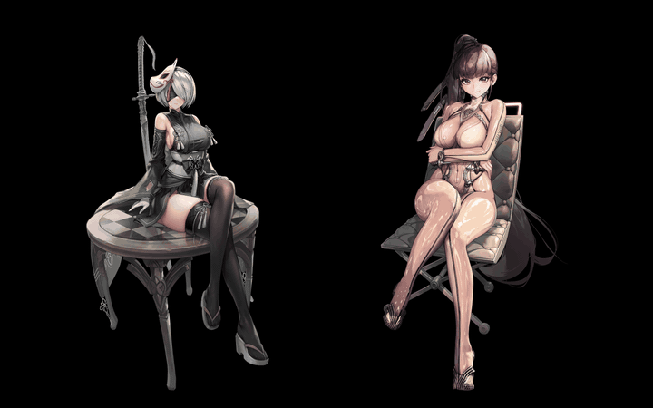
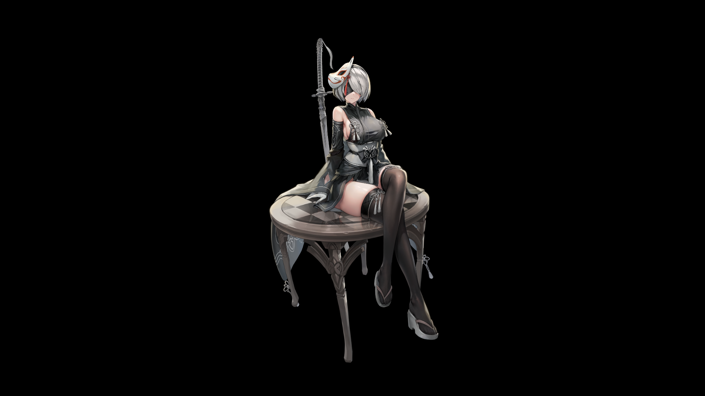
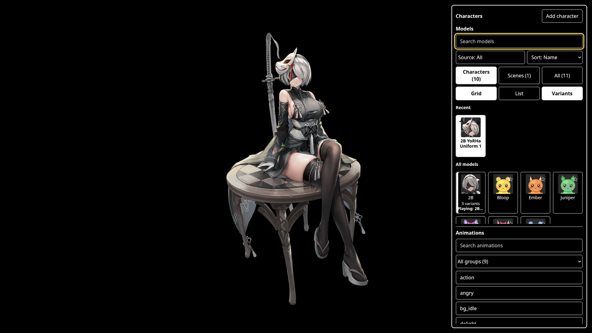
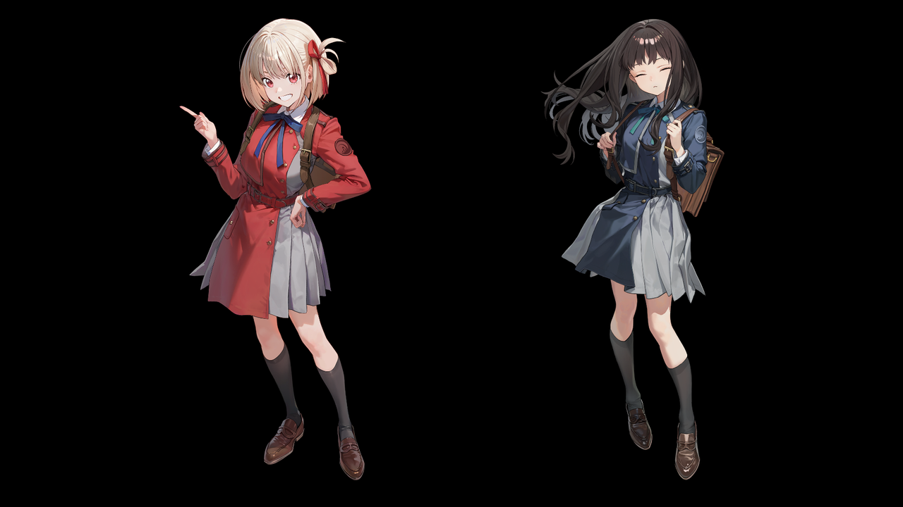
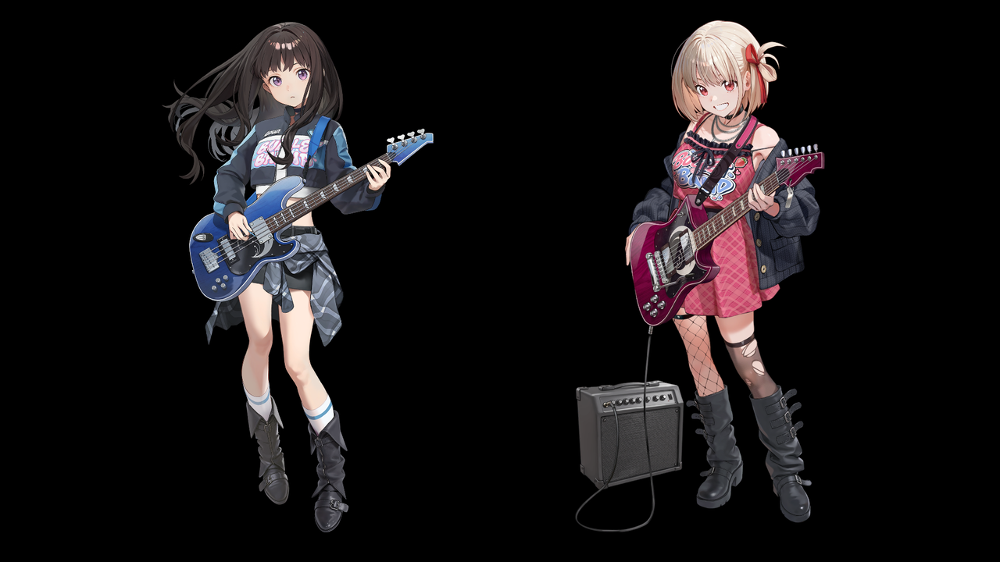
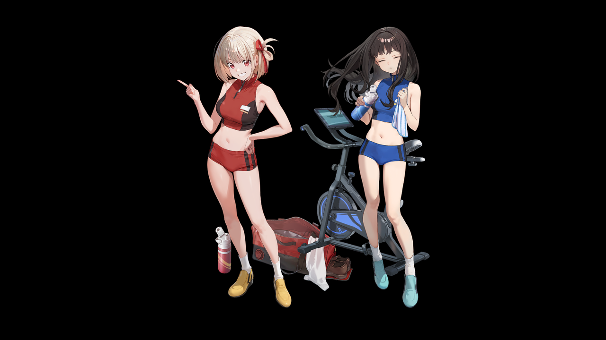
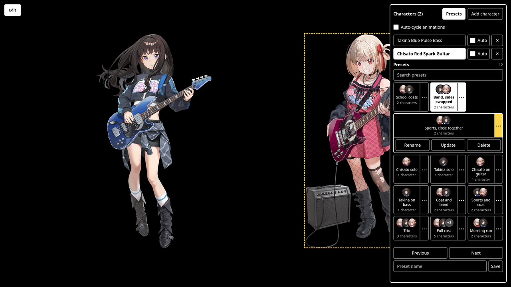
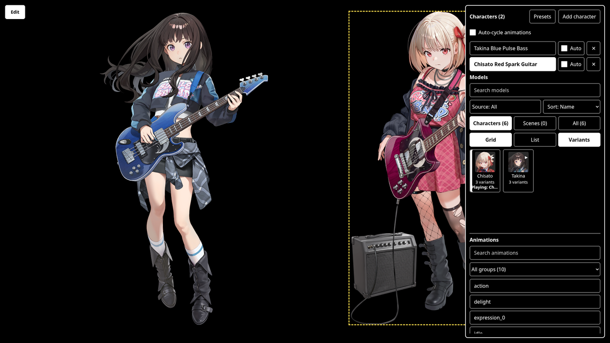
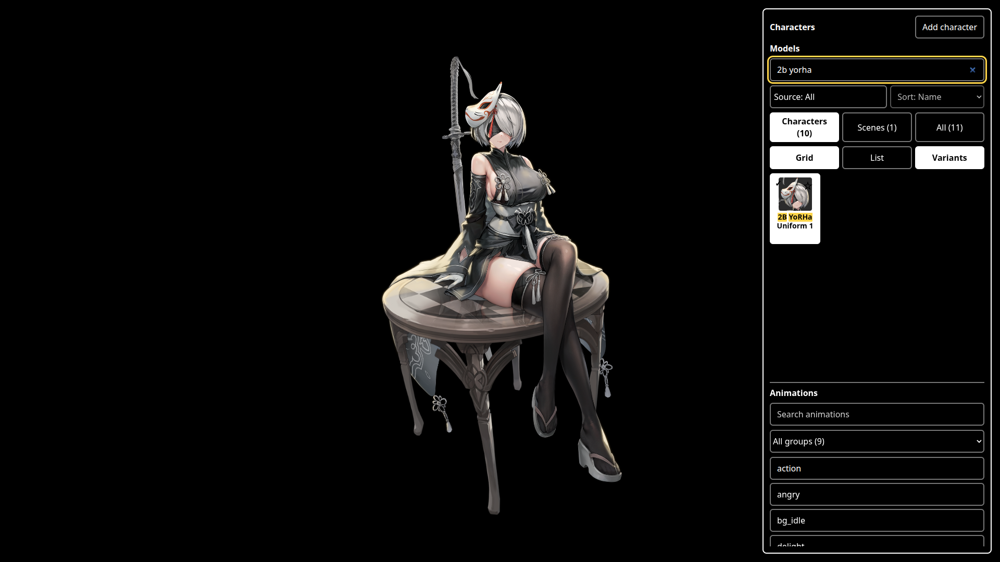

# spinewall

[](https://github.com/officialdad/spinewall/actions/workflows/ci.yml)
[](https://github.com/officialdad/spinewall/releases)
[](LICENSE)

Live 2D animated characters as a KDE Plasma 6 wallpaper, on a black background. Click a character to change its animation.

Spinewall works with any Spine 3.7 (JSON export only), 3.8, 4.0, 4.1, or 4.2 model. It is not tied to one game.

<table>
<tr>
<td align="center"><br><sub>Two characters on one wallpaper, each playing its own animation. <a href="docs/images/hero.mp4">Smaller MP4</a></sub></td>
</tr>
</table>

## Live demo

Try it in the browser at [officialdad.github.io/spinewall](https://officialdad.github.io/spinewall/). The demo has a few sample variants of two characters. Pick a variant, play an animation, add a second character, drag to move, and scroll to scale. It needs no install and runs only in your browser.

## What it looks like

In normal mode the desktop shows only the character. Click it to change its animation.

Edit mode keeps the wallpaper usable. The selected character carries a handle on the canvas, and a chip bar on the bottom edge holds the common actions. Nothing covers a character: the stage fits the free area above the bar and beside the dock. The browse dock opens on request. Right-click the desktop and choose "Enter Edit Mode" to open it.

<table>
<tr>
<td align="center"><br><sub>Normal mode: only the character</sub></td>
<td align="center"><br><sub>Edit mode: the model picker and animation list</sub></td>
</tr>
</table>

In edit mode you can:

- Search models with fuzzy matching, and filter by source, favorites, recents, and Characters, Scenes, or All.
- Group the variants of one character into a single card.
- Save the characters, positions, and sizes on screen as a named preset, and load it again later. Rename a preset, or update it with the layout on screen. See [Presets](#presets).
- Run a different preset on each monitor, and step through the presets with Previous and Next or a global shortcut. See [docs/assets.md](docs/assets.md).
- Play any animation from the list, with a preview on hover.
- Drag the character to move it. Scroll the mouse wheel to scale it.
- Add more characters with "Add character". Press a character to select it. A click changes only the topmost character under the pointer.

Spinewall draws several characters on one wallpaper. Each character keeps its own model, animation, position, and scale. In edit mode, the Characters list shows every character on screen. A dashed yellow box marks the selected one.

Each character picks its own outfit, position, and size. The same two characters (Chisato and Takina) fill three layouts below. Each layout uses a different outfit pair and a different placement:

<table>
<tr>
<td align="center"><br><sub>School coats, standing apart</sub></td>
<td align="center"><br><sub>Band outfits, sides swapped</sub></td>
<td align="center"><br><sub>Sports sets, close together</sub></td>
</tr>
</table>

Save each arrangement as a preset, then switch between them with `spinewall next-preset`.

### Presets

Press **Presets** in the Characters strip to open the preset screen. It shows one card for each preset, with a picture of each character, the name, and the character count. A card past three characters ends in a "+N" chip.

- Press a card to load it. The loaded card is white.
- Type in **Search presets** to narrow a long list. The list takes up to 200 presets and scrolls inside the panel.
- Press ⋯ on a card to **Rename** it, **Update** it with the layout on screen, or **Delete** it. Update and Delete ask for a second press.
- **Previous** and **Next** step through the list in saved order. A rename keeps the order.
- On the command line, `spinewall update-preset NAME` and `spinewall rename-preset OLD NEW` do the same. See [docs/assets.md](docs/assets.md).

<table>
<tr>
<td align="center"><br><sub>The preset screen. The white card is loaded, and the open card shows its actions.</sub></td>
</tr>
</table>

<table>
<tr>
<td align="center"><br><sub>Two characters, edit mode</sub></td>
<td align="center"><br><sub>Fuzzy search in the picker</sub></td>
</tr>
</table>

Chisato and Takina belong to their rights holders. SHIFT UP Corporation made the models in these images. Spinewall is not affiliated with either. They are shown to demonstrate the interface only. The only models in this repository are the few samples for the live demo, under `docs/demo/models/`. Spinewall does not install any models.

## Spine, not Live2D Cubism

"Live 2D" can mean two different formats. Spinewall plays only [Spine](https://esotericsoftware.com) skeletal animation.

| | Spine (supported) | Live2D Cubism (not supported) |
|---|---|---|
| Maker | Esoteric Software | Live2D Inc. |
| Files | `.skel` or `.json`, `.atlas`, PNG pages | `.moc3`, `.model3.json`, textures |
| Method | Image pieces attached to bones | Textured meshes driven by parameters |

A model with `.moc3` files will not load. Many viewers and games call their Spine characters "Live2D", so check the file extensions.

## How it works

- The `webwallpaper-kde` plugin shows a web page as the desktop background.
- The `spinewall` theme is that page. It draws the model with the Spine WebGL player.
- A local server in the `spinewall` binary on `127.0.0.1:8777` holds the state: model, animation, zoom, position.
- The page polls the server. The `spinewall` CLI and global shortcuts send commands to it.

## Input

| Mode | Input | Action |
|---|---|---|
| Normal | Left click | Next animation of the topmost character under the pointer |
| Edit | Left drag | Move the selected character |
| Edit | Mouse wheel | Zoom the selected character |
| Edit | Short left click | Next animation, or select the character |
| Edit | Handle above the character | Previous or next animation, change model, or remove the character |
| Edit | Bottom chip bar | Select a character, add one like it, or open Browse |
| Edit | Keyboard | Every chip, handle button, Add, and Browse works with Tab and Enter |
| Edit | `P` or the Editor button | Open or close the browse dock. The stage resizes to the free area, so the dock never covers a character |
| Edit | `Esc` | Close the browse dock |

Edit mode starts with the browse dock closed, so only the handle and the chip bar sit over the wallpaper. The handle and the bar never cover a character: the stage fits the free area above the bar and beside the dock, with a strip held for the handle above the selected character. Open the dock with Browse, the handle's Change model button, or `P`. It holds a model picker with fuzzy search, a source filter, favorites, recents, character-variant grouping, a Characters / Scenes / All filter, an animation list with hover preview, and a strip for several characters at once. Dock side stays between runs. See [docs/assets.md](docs/assets.md).

Enter edit mode from the Edit button in the corner (native view), or from the Plasma desktop menu: right-click the desktop, then choose "Enter Edit Mode" (KDE legacy). Hold-to-edit is disabled by the plasmoid patch. `spinewall edit` flips it from a shortcut either way.

## Requirements

Spinewall has two backends. `spinewall doctor` reports which one this machine can run and names the exact package command.

- **Native layer-shell view** (recommended where it works). One layer-shell window per monitor draws the page in Qt WebEngine. No plugin and no containment patch. It needs a Wayland compositor with `zwlr_layer_shell_v1` (KDE Plasma, sway, Hyprland, river, labwc, Wayfire), Qt WebEngine, layer-shell-qt, and a C++ toolchain with `moc` and `pkg-config` to build the small launcher. The click mask that used to need the Plasma patch is handled by the launcher.
- **KDE Plasma legacy** (fallback). The `webwallpaper-kde` plugin plus the patched desktop containment. Needs KDE Plasma 6 and the plugin. It stays installable until the native view replaces it everywhere.

Both need `curl` or `wget` for the one-line install. The server, the CLI, and the runtime fetch need no Python or npm: they are in one static Go binary.

- Spine models. See [docs/assets.md](docs/assets.md).

## Supported versions

| Component | Version |
|---|---|
| KDE Plasma | 6.x. The native view is tested on 6.8 Wayland. The containment patch targets 6.8.1. |
| Wayland compositors | Any with `zwlr_layer_shell_v1`. KDE Plasma and wlroots-style compositors. |
| Spine models | 3.7 (JSON only), 3.8, 4.0, 4.1, 4.2 |
| Spinewall | The latest release. See [SECURITY.md](SECURITY.md). |

## Install

One command downloads the release binary, verifies it, and starts a setup wizard:

```
curl -fsSL https://github.com/officialdad/spinewall/releases/latest/download/install.sh | sh
```

The bootstrap downloads `spinewall-<version>-linux-<arch>` and `SHA256SUMS`, checks the hash, and verifies the release signature with `minisign`. A missing `minisign`, a missing signature, or a bad signature stops the install. `SPINEWALL_SKIP_VERIFY=1` skips the signature check, with a warning. It then installs the binary to `~/.local/bin/spinewall` and runs `spinewall setup`.

Prefer another way:

- **Go:** `go install github.com/officialdad/spinewall/cmd/spinewall@latest`, then run `spinewall setup`.
- **Tarball:** download `spinewall-X.Y.Z.tar.gz` and `SHA256SUMS` from the [releases page](https://github.com/officialdad/spinewall/releases). Run `sha256sum -c --ignore-missing SHA256SUMS`, extract the archive, and run `go build -o spinewall ./cmd/spinewall`, then `./spinewall setup`.

`spinewall setup` is a terminal wizard. Run it yourself to see each step, or `spinewall setup --yes` for a non-interactive run with defaults. Each step is skippable and safe to run again:

1. `spinewall doctor` shows what the machine has and names the exact package command for your distro. It never runs a package manager.
2. The Spine licence notice, with a consent prompt.
3. Fetches the Spine runtimes into `~/.cache/spinewall/runtime` (under `$XDG_CACHE_HOME` when set), checking each download against a pinned sha256.
4. Asks for the models folder, kept in `~/.config/spinewall/config.json`.
5. Chooses a backend. The native layer-shell view installs when this machine can build it; the KDE Plasma legacy backend is always offered as the fallback.
6. Installs the files, an XDG autostart entry, and optionally a systemd user unit, then starts the server and verifies it with `/info`. For the KDE Plasma legacy backend the install links the fetched players into the theme folder (`~/.local/share/webwallpaper/themes/spinewall`), because the KDE backend opens the page from `file://` and the page loads each player by relative URL. A refetch or `spinewall runtime fetch` relinks them. The opt-in systemd unit mounts the theme folder read-only, so a server under it cannot relink the players and logs that once. Run `spinewall runtime fetch` or `spinewall setup` to relink them. A `--runtime-dir` or `SPINEWALL_RUNTIME_DIR` that is not the default cache, and not the one the theme links to, never touches the installed theme or its manifest.

Run `spinewall doctor` on its own at any time, and paste its table into a bug report.

Then finish the desktop side for your backend:

**Native layer-shell view.** setup writes the launcher source to `~/.cache/spinewall/view` and builds it. The autostart entry runs `spinewall serve --with-view`, which serves the page and draws one layer-shell window per monitor. Nothing else is needed: no plugin, no patch. Click a character to change its animation. Enter edit mode from the Edit button in the corner, or bind `spinewall edit` to a shortcut. A click on the character reaches the page and a click elsewhere reaches the desktop, because the launcher keeps the window's input mask around the characters. See [docs/native-view.md](docs/native-view.md).

**KDE Plasma legacy.** Run these once after setup:

1. Run `scripts/patch-plasmoid.sh`. It lets left clicks reach the wallpaper. See the warning below.
2. Restart plasmashell: `systemctl --user restart plasma-plasmashell.service`.
3. Put models in `~/.local/share/spinewall/models/` (or the folder you chose), then run `spinewall rescan`. See [docs/assets.md](docs/assets.md).
4. Right-click the desktop, open "Configure Desktop and Wallpaper", choose "WebWallpaper", and pick the `spinewall` theme.

**Autostart.** The wizard writes `~/.config/autostart/spinewall.desktop`. The native backend runs `spinewall serve --with-view`; the KDE legacy backend runs `spinewall serve`. If a systemd user session is detected it offers `~/.config/systemd/user/spinewall.service` as an opt-in. sway, Hyprland, and river do not run XDG autostart entries, so the wizard prints the line for yours. Spinewall never edits a compositor config for you.

| Compositor | File | Line |
|---|---|---|
| sway | `~/.config/sway/config` | `exec ~/.local/bin/spinewall serve --with-view` |
| Hyprland | `~/.config/hypr/hyprland.conf` | `exec-once = ~/.local/bin/spinewall serve --with-view` |
| river | `~/.config/river/init` | `riverctl spawn "~/.local/bin/spinewall serve --with-view"` |

**Old Python install.** `spinewall setup` and `spinewall doctor` warn when `~/.local/bin/spinewall-server` or its systemd unit is still present. setup then writes no autostart entry or unit and starts no server, because both servers use one port. Run `spinewall uninstall --legacy`, then `spinewall setup` again. `--alongside-legacy` installs autostart anyway.

## CLI

```
spinewall info
spinewall next-model | prev-model | random-model | set-model ID
spinewall next-anim | prev-anim | random-anim | set-anim NAME
spinewall zoom-in | zoom-out | move-left | move-right | move-up | move-down | reset-view
spinewall rescan
spinewall add-character [ID] | remove-character UID | clear-characters
spinewall next-char-anim UID | prev-char-anim UID | set-char-anim UID NAME | set-char-model UID ID
spinewall presets | save-preset NAME | update-preset NAME | rename-preset OLD NEW
spinewall load-preset NAME | delete-preset NAME
spinewall next-preset | prev-preset
spinewall screens
spinewall edit [on|off]
spinewall view [--layer bottom|background] [--list-monitors]
spinewall --screen KEY next-preset
spinewall --screen current next-preset
```

On a multi-monitor desktop each monitor has its own layout and preset. A command reaches every monitor unless it carries `--screen KEY`. `spinewall screens` lists the keys. `spinewall mask` prints the native view's current click region.

Bind these to global shortcuts in System Settings, under Shortcuts, with a custom command. To cycle presets on the monitor you are using, bind `spinewall next-preset --screen current` and `spinewall prev-preset --screen current`. Bind `spinewall edit` to enter or leave edit mode from any monitor.

## Code map

| Path | Job |
|---|---|
| `theme/index.html` | The wallpaper page. One file, no build step. |
| `theme/local-host.js` | Local mode. Runs the server's state logic in the page, with `localStorage` for state and prefs. |
| `theme/embed.go` | Embeds the page and local host into the Go binary. Never embeds the Spine players. |
| `server/spinewall-server.py` | Local HTTP server. State, model scan, prefs, layout, thumbnails. |
| `cmd/spinewall` | The one binary. `spinewall serve` is a drop-in for the Python server. `spinewall setup`, `doctor`, `install`, `uninstall`, and `build-theme` manage an install; `spinewall runtime fetch\|verify` manages the players. Any other argument is a client command against a running server. |
| `internal/cli` | The client commands. Percent-encoding, the 3-argument limit, the shortcut log, and `--screen current` over D-Bus on KDE. |
| `internal/api` | Go HTTP handlers, guards, body caps, model file serving. |
| `internal/state` | Go stage, characters, presets and prefs logic. |
| `internal/runtime` | Pins the Spine players by sha256, fetches and verifies them into `SPINEWALL_RUNTIME_DIR` (default under the user cache), and serves them. Never embeds them. |
| `internal/scan` | Go model scan, version sniff, atlas regions, kind detection. |
| `internal/jx` | Go JSON decoder that matches Python `json.loads`, so both servers read a body the same way. |
| `internal/doctor` | Detects session, desktop, layer-shell, GPU, web engine, systemd, and network, and names the distro package command. Never runs a package manager. |
| `internal/install` | The install manifest, install and uninstall, the XDG autostart entry, the opt-in systemd unit, and the legacy uninstall. For the KDE legacy backend it links the cached Spine players into the theme folder, as symlinks into the cache or copies, so the `file://` page finds them, and records them so uninstall removes the links but not the cache. |
| `internal/view` | The native layer-shell backend. Detects the compositor and toolchain, embeds the launcher source and `view.qml`, builds the launcher on the user's machine, and runs one window per monitor. |
| `internal/tui` | The `setup` wizard: huh and bubbletea forms that run the doctor, the licence consent, the runtime fetch, the install, and the start-and-verify. |
| `bin/spinewall` | Deprecated shim. Runs a built `spinewall` binary when one is next to it, so the legacy installer keeps working until the installer phase. It holds no CLI logic. |
| `scripts/build-demo.py` | Builds the Pages demo from `theme/index.html` in local mode. |
| `scripts/package-windows.py` | Builds the Lively zip and Wallpaper Engine files for Windows. See [docs/windows.md](docs/windows.md). Unconfirmed on Windows. |
| `scripts/install.sh` | The POSIX bootstrap: downloads the release binary, verifies it, and runs `spinewall setup`. |
| `scripts/patch-plasmoid.sh` | Applies `plasma/desktopcontainment.patch`. |
| `systemd/spinewall.service` | The hardened user unit the wizard can generate as an opt-in. |
| `docs/native-view.md` | How the layer-shell backend works: the launcher, the input mask, per-monitor windows, and the reload on resume. |
| `docs/assets.md` | Model layout and `model.json` keys. |
| `docs/credits.md` | Sources, tools, and test models. |

### `theme/index.html`

| Area | Functions |
|---|---|
| Config and runtimes | `RUNTIMES` (`spine37`, `spine38`, `spine40`, `spine41`, `spine42`), `API`, `LOCAL`, `MODEL_ROOT`, `api`, `POLL_MS`, click and scale limits |
| View and polling | `applyView`, `pushView`, `poll`, `load`, `setEditMode` |
| Picker data | `refreshPrefs`, `fuzzy`, `matchModel`, `comparator`, `buildItems` |
| Picker UI | `ensureChrome`, `renderPicker`, `computeLayout`, `renderWindow`, `makeCell`, `drawRail`, `setupRailScrub`, `onSearchKey` |
| Animation list | `drawingAnimations`, `animGroups`, `renderAnims`, `previewAnim`, `endPreview` |
| Thumbnails | `wantThumb`, `pumpThumbs`, `loadOrMakeThumb`, `renderThumb`, `headBox`, `unionBox` |
| Stage (all characters) | `makeLayer`, `createStageChar`, `stageFrame`, `frameOf`, `applyCharacters`, `destroyLayers` |
| Hit testing | `hitTest`, `charContains`, `inTriangle`, `selectChar` |
| Chip bar and handle | `renderBar`, `placeHandle`, `openSheet`, `stepSelectedAnim`, `removeSelected`, `addCharacterLikeSelected` |
| Editor dock | `applyDock`, `updateFit`, `setDockFolded`, `loadDockPrefs`, `saveDockPrefs` |
| Scenes | `hideSlotsOf`, `kind` filter in `buildItems` |
| Presets pane | `setPresetsOpen`, `renderPresets`, `makePresetCard`, `makePresetManage`, `savePreset`, `updatePreset`, `renamePreset`, `loadPreset`, `stepPreset`, `deletePreset`, `revealCurrentPreset` |

### `theme/local-host.js`

| Area | Functions |
|---|---|
| Entry | `createLocalHost` answers the server paths from memory and `localStorage`. |
| Model list | `completeModels` fills the fields a server scan derives. |
| State | `runCommand`, `setView`, `changeModel`, `changeAnimation`, `setLayout`, `cleanCharacters` |
| Presets | `savePreset`, `updatePreset`, `renamePreset`, `loadPreset`, `stepPreset`, `deletePreset` |

Local mode starts with `?local=<models index url>` or `window.SPINEWALL_LOCAL = {modelsUrl}`. The index is `{"runtime": "4.1.56", "models": [...]}` like `docs/demo/models/index.json`. The model folders sit beside it. A visible Edit button replaces the Plasma patch.

### `server/spinewall-server.py`

| Area | Functions |
|---|---|
| Model scan | `read_binary_version`, `read_json_version`, `read_atlas_regions`, `classify_kind`, `scan_model`, `scan_models`, `assign_characters`, `rescan` |
| State | `STATE`, `clean_stage`, `save`, `change_model`, `change_animation`, `set_view` |
| Screens | `DEFAULT_STAGE`, `SCREENS`, `screen_stage`, `on_stage`, `all_stages`, `clean_screen_key`, `load_screens` |
| Prefs | `load_prefs`, `save_prefs`, `toggle_favorite`, `record_recent`, `set_prefs` |
| Presets | `save_preset`, `update_preset`, `rename_preset`, `load_preset`, `step_preset`, `delete_preset`, `current_characters`, `clean_preset`, `clean_presets`, `clean_preset_name` |
| Characters | `add_character`, `remove_character`, `update_character`, `cycle_character_animation`, `set_layout`, `clean_characters` |
| HTTP | `command`, `Handler`: `/state`, `/models`, `/prefs`, `/info`, `/rescan`, `/presets`, `/screens`, `/thumb/<id>.png`, `/cmd/...`, `/edit/0\|1`, `/report`, `/fav/<id>`, `/layout`, `/view`, `/input` |

Data flow, state keys, and rules are in `CLAUDE.md`.

## Test models

Models are never committed, except the demo samples in `docs/demo/models/`. Test with the Esoteric Software example projects from the [spine-runtimes](https://github.com/EsotericSoftware/spine-runtimes) repo (`spineboy`, `raptor`, `goblins`, `hero`, `vine`, `stretchyman`, in 4.0 and 4.1), and with models you own.

1. Copy a model directory into `~/.local/share/spinewall/models/`.
2. Run `spinewall rescan`.
3. Run `spinewall set-model spineboy-4.1`.

See [docs/assets.md](docs/assets.md) for the layout.

## Credits

See [docs/credits.md](docs/credits.md).

- [Esoteric Software](https://esotericsoftware.com): Spine and [spine-runtimes](https://github.com/EsotericSoftware/spine-runtimes).
- [webwallpaper-kde](https://github.com/ekoputrapratama/webwallpaper-kde): the web page wallpaper plugin.
- [Nikke-db](https://github.com/Nikke-db): open-source viewer studied for skin handling and viewer behavior.

## Plasmoid patch warning

`plasma/desktopcontainment.patch` changes a copy of the Plasma desktop containment. The copy lives in `~/.local/share/plasma/plasmoids/org.kde.desktopcontainment` and shadows the system one.

The patch has three effects:
- Desktop icons no longer take left clicks, so the click reaches the wallpaper.
- Hold-to-enter-edit-mode is off.
- The containment tells the server when edit mode starts and stops.

Run `scripts/patch-plasmoid.sh` again after every `plasma-desktop` update. A stale copy can break the desktop. To undo, remove the local directory and restart plasmashell.

## First run

1. Copy one model into `~/.local/share/spinewall/models/`.
2. Run `spinewall rescan`, then `spinewall info`. The `models` count must rise.
3. Run `spinewall set-model <id>`.
4. Right-click the desktop and choose "Enter Edit Mode" to open the picker.

## Security

The server listens on `127.0.0.1` only. See [SECURITY.md](SECURITY.md) to report a problem.

## Contributing

Read [CONTRIBUTING.md](CONTRIBUTING.md) and [CODE_OF_CONDUCT.md](CODE_OF_CONDUCT.md). Releases are automatic. See [docs/releasing.md](docs/releasing.md).

## Legal notice

Spinewall is a viewer. It includes no Spine runtime. The only models are the few samples for the live demo, shown as samples only under `docs/demo/models/`, and removed on request from their owners. `spinewall setup` fetches the runtimes from Esoteric Software on your machine. Each user needs their own Spine Editor license under the Spine Runtimes License. The demo characters (Chisato and Takina) belong to their rights holders. SHIFT UP Corporation made the demo models and owns the related art and models. Spinewall is a fan project. Neither SHIFT UP nor those rights holders sponsor, endorse, or affiliate with it. Other game characters and art belong to their owners, and Spinewall has no affiliation with them. Use only models you own or have the right to use, for personal non-commercial use. The MIT license covers this repository's code only.

## Configuration

| Variable | Default | Use |
|---|---|---|
| `SPINEWALL_PORT` | `8777` | Server and CLI port. The theme and the Plasma patch hardcode `8777`, so a changed port breaks the wallpaper. |
| `SPINEWALL_MODELS` | `~/.local/share/spinewall/models` | Model directory. |
| `SPINEWALL_CONFIG` | `~/.config/spinewall/config.json` | Config file. `additional_model_dirs` lists more model directories, see [docs/assets.md](docs/assets.md). |
| `SPINEWALL_STATE` | `~/.local/state/spinewall/state.json` | Current model, animation, and view. |
| `SPINEWALL_PREFS` | `~/.local/state/spinewall/prefs.json` | Favorites, recents, sort, filters, presets. |
| `SPINEWALL_LAYOUT` | `~/.local/state/spinewall/layout.json` | Several-character layout. |
| `SPINEWALL_SCREENS` | `~/.local/state/spinewall/screens.json` | Layout and last preset of each monitor. |
| `SPINEWALL_THUMBS` | `$XDG_CACHE_HOME/spinewall/thumbs`, `~/.cache/spinewall/thumbs` when unset | Thumbnail cache. |
| `SPINEWALL_RUNTIME_DIR` | `$XDG_CACHE_HOME/spinewall/runtime`, `~/.cache/spinewall/runtime` when unset | Fetched Spine players and the cache manifest. |
| `SPINEWALL_OFFLINE` | unset | Set to `1` to refuse every runtime fetch and use only the cache. |

The server listens on `127.0.0.1` only and rejects requests with another `Host` header. It has no login. Any local user can send it commands.

## Troubleshooting

| Symptom | Action |
|---|---|
| Blank wallpaper | Run `spinewall info`. Check `models` and `skipped`. Restart plasmashell. |
| A model is missing | Run `spinewall rescan`. Read its reason under `skipped`. |
| A model has no picture | Run the atlas page check in [docs/assets.md](docs/assets.md). |
| Clicks do nothing | Run `scripts/patch-plasmoid.sh` again and restart plasmashell. Check that `input.fired` rises. |
| Black or broken after a screen lock | Restart plasmashell. The page reloads on resume. |

## Uninstall

```
spinewall uninstall
```

The installer records every file it writes in `~/.local/state/spinewall/install-manifest.json` with its sha256. `spinewall uninstall` removes exactly those files, stops the server, and asks before it touches `~/.local/state/spinewall` and `~/.cache/spinewall` (under `$XDG_CACHE_HOME` when set), which hold your prefs, the thumbnails, and the runtime cache. It never touches the models directory.

- `spinewall uninstall --yes` removes state and cache too, which returns a fresh install to its starting home.
- `spinewall uninstall --purge` removes state and cache without asking.
- `spinewall uninstall --keep-state` keeps your prefs and the runtime cache.
- `spinewall uninstall --legacy` removes an old Python install (`~/.local/bin/spinewall-server`, the old unit, and the patched containment copy, restoring its `.bak` when present), then this install too. While any old install file is present it removes the whole theme under `~/.local/share/webwallpaper/themes/spinewall`, which still holds the old Spine players. Run `spinewall setup` again afterwards.

Then restart plasmashell if you removed the containment patch.

## Not included

- Spine models. You supply them. Use only models you have the right to use.
- The Spine runtime. `spinewall setup` fetches it from npm and a pinned `spine-runtimes` commit on your machine. Its license is the Spine Runtimes License, so you need a Spine license to use it in your own product.

## Status

Version 0.1.0 is the first public release. The wallpaper, edit mode, model picker, several characters at once, and scene filtering work. Expect changes before 1.0.0. Check the real desktop after each change.

## License

MIT, for the code in this repository. See [docs/license-choice.md](docs/license-choice.md). The Spine runtimes and your models keep their own licenses.
